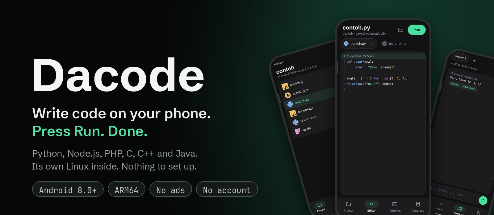
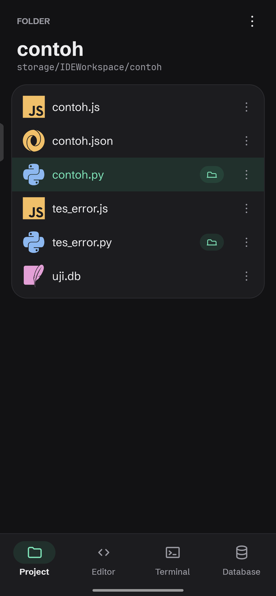
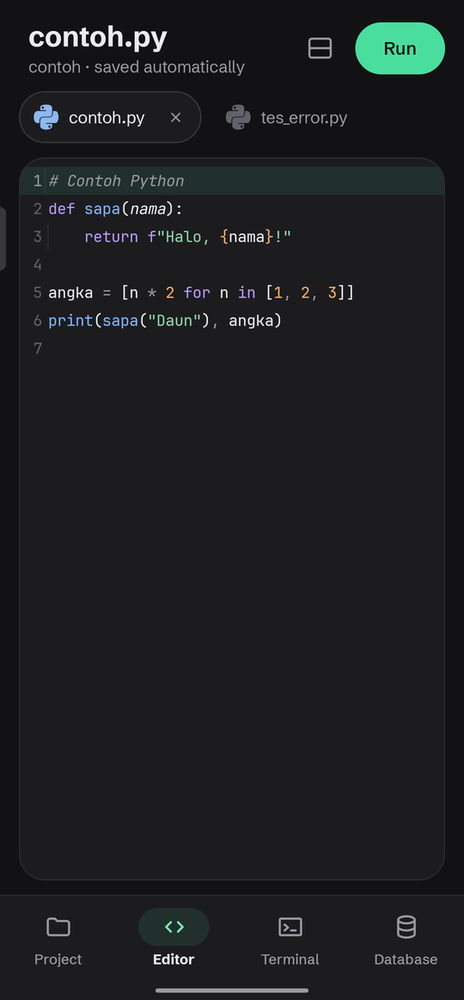
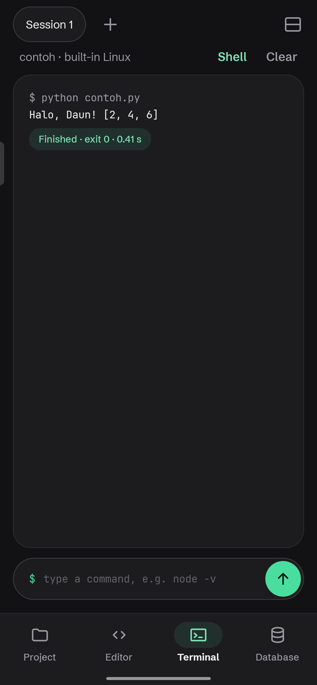
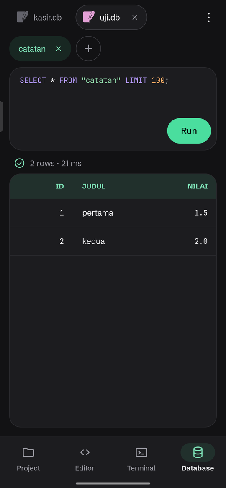

<div align="center">



<br>

[](https://github.com/fraghieh/dacode/releases/tag/v0.1)
[](#requirements)
[](#requirements)

### [Download for Android](https://github.com/fraghieh/dacode/releases/download/v0.1/Dacode.apk)

[Website](https://dacode-app.netlify.app) &nbsp;&nbsp;|&nbsp;&nbsp; [Release notes](https://github.com/fraghieh/dacode/releases/tag/v0.1) &nbsp;&nbsp;|&nbsp;&nbsp; [Report an issue](https://github.com/fraghieh/dacode/issues/new/choose)

</div>

<br>

## Your code editor, ready the moment you open it

Dacode is an Android app that lets you write, run and test real code on your phone. It carries its own Linux environment, so the languages you need are already installed. You open a file, tap **Run**, and see the result.

There is no account to create, no server to configure and no ads between you and your work.

<br>

<div align="center">
<table>
  <tr>
    <td align="center"></td>
    <td align="center"></td>
    <td align="center"></td>
    <td align="center"></td>
  </tr>
  <tr>
    <td align="center"><b>Projects</b><br><sub>Your files in one place</sub></td>
    <td align="center"><b>Editor</b><br><sub>Clear colors, tabs, one tap to run</sub></td>
    <td align="center"><b>Terminal</b><br><sub>Results appear right away</sub></td>
    <td align="center"><b>Database</b><br><sub>Query SQLite files</sub></td>
  </tr>
</table>
</div>

<br>

## What you get

| | |
|---|---|
| **Ready to run** | Python, Node.js, PHP, C, C++ and Java 17 come with the app. No installation steps and no setup scripts. |
| **A real Linux terminal** | Dacode includes its own Alpine Linux, so you also get a standard command line. It needs no root access and no other apps. |
| **An editor designed for a phone** | Syntax colors for JSON, HTML, CSS, JavaScript, Python, PHP, C, C++ and Java. Multiple tabs, code suggestions and automatic saving. |
| **Web preview** | Edit HTML, CSS and JavaScript and see the page next to your code. |
| **SQLite built in** | Open a database file, write a query and read the table. No server involved. |
| **Works offline** | Your languages live on your phone, so Dacode keeps working without a connection. |
| **Private by design** | No ads and no account. Your projects stay in a normal folder on your device. |
| **Light and dark themes** | Pick the one that suits your eyes and your surroundings. |

<br>

## Install

1. Download [Dacode.apk](https://github.com/fraghieh/dacode/releases/download/v0.1/Dacode.apk) on your phone. The file is about 393 MB, so a WiFi connection is a good idea.
2. Open the file. If Android asks, allow your browser or file manager to install unknown apps.
3. Tap **Install**, then open **Dacode**.
4. On the first start, Dacode prepares its Linux environment. This takes about a minute and happens once.
5. When asked, allow access to all files. Your projects are kept in a regular folder, so they remain if you reinstall the app.

Dacode is not on Google Play yet. Android treats it as a sideloaded app and may show a standard warning. That is expected.

<br>

## Check your download

Confirm that the file is exactly the one we published. On a computer, or in a terminal on your phone, run:

```bash
sha256sum Dacode.apk
```

The result must be:

```text
d2ea08195c5f4d044769f1e81fe1e530d0c410223166edfa9366498859219e44
```

If the value is different, do not install the file. Download it again from the [release page](https://github.com/fraghieh/dacode/releases/tag/v0.1).

<br>

## Requirements

| | |
|---|---|
| **Android** | Version 8.0 or newer. Tested on Android 16 with two phone brands. |
| **Processor** | ARM64, which covers almost every phone made in recent years. 32 bit and x86 devices are not supported. |
| **Storage** | About 1.5 GB of free space after installation. |
| **Permission** | Access to all files, so that your projects live in a regular folder. |

<br>

## Status of version 0.1

Dacode 0.1 is our first public release. It runs well on the phones we tested, and it will keep changing as we listen to feedback.

* **Background activity.** Some phones pause apps that are not on screen. If a long program stops when you leave Dacode, open Settings and use the battery option that lets Dacode keep running.
* **First start.** The initial setup needs about a minute and some free space.
* **Signing.** This build is signed with a temporary key. When the final signed version is released, Android will ask you to uninstall this one first, so keep a copy of your projects.

<br>

## Share your feedback

Early releases improve through the people who use them. If something breaks, feels wrong or is missing, please [open an issue](https://github.com/fraghieh/dacode/issues/new/choose) and tell us:

* your phone model and Android version
* the Dacode version, shown in Settings under About
* what you did, what you expected, and what happened instead

<br>

## Open source notices

Dacode is built on open source software, including Alpine Linux, proot, Sora Editor and components of the Termux terminal. The full list and license texts are available inside the app under Settings, Open source licenses, and in [Licenses.txt](https://github.com/fraghieh/dacode/releases/download/v0.1/Licenses.txt). Programming language logos belong to their respective owners.

<br>

<div align="center">
<sub>This repository provides downloads and issue tracking for Dacode.<br>Made by <a href="https://github.com/fraghieh">fraghieh</a>.</sub>
</div>
